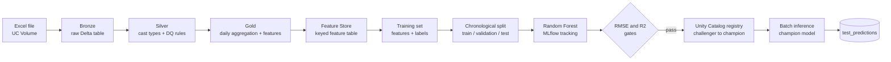

# Oil & Gas Supply Chain Demand Forecasting — MLOps on Databricks

[](https://github.com/HarshAI-ML/oil_gas_mlops/actions/workflows/bundle-ci.yml)

An end-to-end, production-style MLOps pipeline that forecasts **daily demand quantity per product and destination city** for an oil & gas supply chain. It is built on Databricks and covers the full lifecycle: raw data ingestion, medallion data engineering, feature engineering with the Databricks Feature Store, model training and tracking with MLflow, a quality-gated model registry in Unity Catalog with champion/challenger promotion, scheduled batch inference, and CI/CD with GitHub Actions.

---

## Table of contents

1. [Highlights](#highlights)
2. [Architecture](#architecture)
3. [Pipeline stages](#pipeline-stages)
4. [Model lifecycle](#model-lifecycle)
5. [Project structure](#project-structure)
6. [Configuration](#configuration)
7. [Getting started](#getting-started)
8. [CI/CD](#cicd)
9. [Scheduling and notifications](#scheduling-and-notifications)
10. [Testing and code quality](#testing-and-code-quality)
11. [Tech stack](#tech-stack)
12. [Known limitations and next steps](#known-limitations-and-next-steps)

---

## Highlights

- **Medallion architecture** (bronze, silver, gold) on Delta Lake, with Unity Catalog governance.
- **Config-driven data quality:** type casting and data-quality rules (`NOT_NULL`, `UNIQUE`, `RANGE`, `ALLOWED_VALUES`) are read from Delta config tables, so rules change without code changes.
- **Databricks Feature Store:** features are registered once and joined to labels with `FeatureLookup`, which keeps training reproducible.
- **Time-aware modeling:** lag, rolling and calendar features, plus a **chronological** train/validation/test split to avoid look-ahead leakage.
- **Experiment tracking with MLflow:** parameters, train/validation/test metrics, model signature and input example are logged for every run.
- **Quality-gated registration:** a model is registered in Unity Catalog only if it meets RMSE and R² thresholds.
- **Champion/challenger promotion:** each newly registered version becomes the `challenger` and is promoted to `champion` only if its validation RMSE beats the current champion's.
- **Alias-based inference:** the scoring task always loads `models:/<name>@champion`, so swapping the champion needs no code change.
- **Infrastructure as code:** the whole job is defined with Databricks Asset Bundles.
- **CI/CD:** pull requests are linted, type-checked, unit-tested and bundle-validated; merges to `main` deploy and run the job.

---

## Architecture



The whole flow runs as **one Databricks Job with three dependent tasks**:

| Order | Task key | Entry point | What it does |
|---|---|---|---|
| 1 | `Data_Engineering` | `src/entry_points/run_data_engineering.py` | Bronze, silver and gold layers, plus the gold feature table |
| 2 | `Feature_Eng_to_Model_Training` | `src/entry_points/run_feature_training.py` | Feature store, split, encoding, training, registration, champion/challenger promotion |
| 3 | `Inferencing` | `src/entry_points/run_inference.py` | Loads the champion model and writes predictions |

---

## Pipeline stages

### 1. Bronze: ingestion
`ExcelToBronzeIngestion` reads the source Excel sheet from a Unity Catalog Volume, adds an `ingestion_ts` column, and writes it to `bronze.bronze_supply_chain` as a Delta table.

### 2. Silver: clean and validate
`run_silver` performs these steps:
1. Drops technical columns (`ingestion_ts`, `source_system`, `operation_type`).
2. **Type casting** with `SilverTransformation`, driven by the `config_transformation` table (`table_name`, `column_name`, `target_type`).
3. **Data-quality checks** with `DataQualityChecker`, driven by the `config_dq` table. Only rules with `is_active = true` run. Supported checks:

   | Check | Behavior |
   |---|---|
   | `NOT_NULL` | Drops rows where the column is null |
   | `UNIQUE` | Drops duplicate rows on the column |
   | `RANGE` | Keeps rows within `min` / `max` |
   | `ALLOWED_VALUES` | Keeps rows whose value is in a pipe-separated list of allowed values |

   Each check prints how many rows it dropped.
4. Adds `silver_processed_ts` and writes `silver.silver_supply_chain`.

### 3. Gold: aggregate and engineer features
- **`GoldAggregation`** groups silver data by `transaction_date`, `product_name`, `destination_city` and produces totals and averages (demand, ordered quantity, inventory, costs, lead times, delays, stockouts, quality score, transaction count).
- **`GoldFeatureEngineering`** builds the feature table `gold.feature_table` with:

  | Feature | Description |
  |---|---|
  | `day_of_week`, `month` | Calendar features |
  | `demand_lag_1`, `demand_lag_7` | Previous demand values per product and city |
  | `rolling_avg_7` | 7-row rolling average of demand per product and city |
  | `avg_unit_price_usd`, `total_available_inventory` | Price and inventory drivers |

  The label is `total_demand_quantity`.

### 4. Feature engineering and Feature Store
1. `FeatureTablePreparer` casts `transaction_date` to a date and **validates that the key columns have no nulls and are unique** (`transaction_date`, `product_name`, `destination_city`). The run fails if either check fails.
2. `FeatureLabelSplitter` separates the features table (X) from the labels table (y).
3. `FeatureStoreRegistrar` registers the features as a Databricks Feature Store table, using the three key columns as primary keys.
4. `TrainingSetBuilder` joins labels to features with `FeatureLookup`.

### 5. Split, encode, prepare
- `TimeSeriesSplitter` sorts the distinct dates and splits at a cutoff date, so training data is always earlier than validation data, and validation data is earlier than test data. It runs twice (80% / 20%, then 80% / 20% of the first part), giving roughly **64% train / 16% validation / 20% test** of the distinct dates.
- `CategoricalEncoder` one-hot encodes `product_name` and `destination_city`. It is **fitted on the training set only**, so no information from validation or test leaks into the encoding.
- `PreprocessedDataWriter` saves `train_data`, `validation_data` and `test_data` to the `ml_data` schema.
- `ModelDataPreparer` selects the feature columns (everything except the label and excluded columns) and converts the tables to pandas `X` / `y`, casting to float.

---

## Model lifecycle

**Training.** `RandomForestTrainer` fits a scikit-learn `RandomForestRegressor` (`n_estimators` and `max_depth` from config, `random_state=42`) and evaluates RMSE, MAE and R² on train, validation and test.

**Tracking.** Each run is logged to the MLflow experiment configured in `config.yml`, with parameters, tags, all nine metrics, an inferred model **signature** and an input example. The run name includes a timestamp so runs are easy to tell apart.

**Registration gate.** `ModelRegistrar` registers the model in the Unity Catalog model registry **only if**:

- validation RMSE `< max_rmse`, and
- validation R² `> min_r2`.

Otherwise the run is kept in MLflow for inspection but nothing is registered.

**Champion/challenger.** `ChampionChallengerManager` handles promotion with registry aliases:

1. The newly registered version always receives the `challenger` alias.
2. If no `champion` exists yet, the new version is promoted immediately.
3. Otherwise the champion's validation RMSE is read from its MLflow run and compared with the challenger's. The challenger is promoted only if its RMSE is **strictly lower**.

**Inference.** `ChampionLoader` resolves the `champion` alias and loads that version. `Predictor` checks that the scoring columns match the training columns exactly, then predicts. `PredictionWriter` saves the results to `ml_data.test_predictions` with these columns:

| Column | Meaning |
|---|---|
| `transaction_date`, `product_name`, `destination_city` | Row identifiers |
| `actual_demand`, `predicted_demand`, `absolute_error` | Actual vs. predicted demand and the error |
| `model_name`, `model_version` | Which registered model produced the prediction |
| `prediction_ts` | When the prediction was written |

---

## Project structure

```
oil_gas_mlops/
├── .github/workflows/
│   ├── bundle-ci.yml           # PR checks: bundle validate, ruff, mypy, pytest
│   └── bundle-deploy.yml       # On push to main: deploy bundle and run the job
├── config/
│   └── config.yml              # Tables, columns, split, training and inference settings
├── resources/
│   └── resources.yml           # Databricks Job definition (tasks, schedule, notifications)
├── src/
│   ├── entry_points/           # One script per job task
│   │   ├── run_data_engineering.py
│   │   ├── run_feature_training.py
│   │   └── run_inference.py
│   ├── data_engineering/       # ingestion.py, silver_main.py, silver_transform.py,
│   │                           # silver_dq.py, gold.py
│   ├── feature_engineering/    # feature_table_preparer.py, feature_label_splitter.py,
│   │                           # feature_store_registrar.py, training_set_builder.py,
│   │                           # splitter.py, encoder.py, preprocessed_writer.py
│   ├── modeling/               # data_preparer.py, trainer.py, registrar.py,
│   │                           # champion_manager.py
│   ├── inference/              # champion_loader.py, predictor.py, prediction_writer.py
│   └── utils/
│       └── config_loader.py    # YAML config loader
├── tests/                      # pytest unit tests and shared fixtures (conftest.py)
├── databricks.yml              # Databricks Asset Bundle root (targets)
├── pyproject.toml              # Ruff, Mypy and Pytest configuration
├── requirements.txt            # Runtime dependencies
└── requirements-dev.txt        # Linting, typing and testing dependencies
```

---

## Configuration

All behavior is driven by `config/config.yml`:

| Section | Controls |
|---|---|
| `bronze` | Source Excel path and sheet, target catalog, schema and table, write mode |
| `silver` | Input and output tables, config table names, columns to drop |
| `gold` | Silver, gold and feature table names |
| `feature_store` | Key columns, label column (`total_demand_quantity`), feature and label table names |
| `split` | `train_ratio` and `validation_ratio` for the chronological splits |
| `preprocessing` | Categorical columns, ML schema, train, validation and test table names |
| `training` | Registered model name, `num_trees`, `max_depth`, `max_rmse`, `min_r2`, MLflow experiment path, excluded columns |
| `inference` | Model name, test table, output table, label, id and excluded columns |

Default quality gates: `max_rmse: 1000` and `min_r2: 0.85`.

The Databricks Job itself (tasks, schedule, tags, notifications, environments) lives in `resources/resources.yml`.

---

## Getting started

### Prerequisites

- A Databricks workspace with **Unity Catalog** enabled and serverless jobs compute available.
- [Databricks CLI](https://docs.databricks.com/dev-tools/cli/index.html) installed and authenticated.
- A Unity Catalog catalog named `oil_gas_mlops` with these schemas: `raw`, `bronze`, `silver`, `gold`, `config`, `ml_data`, `ml_models`.
- The source file `supply_chain_dataset.xlsx` (sheet `in`) uploaded to the Volume path set in `bronze.source_path`.
- Two config tables in `oil_gas_mlops.config`:
  - `config_transformation` with columns `table_name`, `column_name`, `target_type`
  - `config_dq` with columns `table_name`, `column_name`, `check_type`, `check_params`, `is_active`
- The `databricks.yml` workspace `host` pointing to your workspace.
- The `config_path` in the `__main__` block of each script in `src/entry_points/` pointing to where `config.yml` lives in your workspace.

### Deploy and run

```bash
# Validate the bundle
databricks bundle validate --target dev

# Deploy the job to the workspace
databricks bundle deploy --target dev

# Run the job (the key is the resource name in resources/resources.yml)
databricks bundle run demand_forecasting_v2 --target dev
```

### Local development

```bash
python -m venv .venv && source .venv/bin/activate
pip install -r requirements.txt -r requirements-dev.txt

ruff check .          # lint
mypy src/             # type check
pytest tests/ -v      # unit tests (requires Java 17 for local Spark)
```

---

## CI/CD

| Workflow | Trigger | Steps |
|---|---|---|
| **Bundle CI** (`bundle-ci.yml`) | Pull request to `main` | **validate:** `databricks bundle validate --target dev`<br>**code-quality:** Python 3.10 and Java 17, install dependencies, `ruff check .`, `mypy src/`, `pytest tests/` |
| **Bundle Deploy** (`bundle-deploy.yml`) | Push to `main` | `databricks bundle deploy --target dev`, then `databricks bundle run demand_forecasting_v2 --target dev` |

**Required GitHub secrets:** `DATABRICKS_HOST` and `DATABRICKS_TOKEN`.

Recommended branch protection on `main`: require a pull request, require the Bundle CI checks to pass, and require branches to be up to date before merging.

---

## Scheduling and notifications

Defined in `resources/resources.yml`:

- **Schedule:** daily at 06:00 (`0 0 6 * * ?`), timezone `Asia/Calcutta`.
- **Email notifications:** on start, success and failure.
- **Run queueing** is enabled.
- **Tags:** `project`, `environment`, `team`, `owner`.
- **Compute:** serverless job environments (version 2) installing `requirements.txt`; performance target `PERFORMANCE_OPTIMIZED`.

To change the recipients, edit the `email_notifications` block in `resources/resources.yml`.

---

## Testing and code quality

Unit tests live in `tests/` and run in CI on every pull request:

| Test file | Covers |
|---|---|
| `test_config_loader.py` | YAML loading, missing and malformed files, type preservation |
| `test_splitter.py` | Chronological split ratio, ordering, no overlap, full coverage |
| `test_encoder.py` | Category learning in `fit`, one-hot column creation, space sanitising, unseen-category behavior |
| `test_data_preparer.py` | Feature column selection, X/y conversion |

`tests/conftest.py` provides a session-scoped local `SparkSession` fixture shared by the Spark-based tests.

Tooling is configured in `pyproject.toml`: **Ruff** (rules `E`, `F`, `I`, `W`), **Mypy** and **Pytest** (`pythonpath = ["src"]`).

---

## Tech stack

Databricks (Jobs, Unity Catalog, Feature Engineering client, Asset Bundles) · Delta Lake · PySpark · MLflow · scikit-learn · pandas · NumPy · PyYAML · GitHub Actions · Ruff · Mypy · Pytest

---

## Known limitations and next steps

- **Single `dev` target.** Add `staging` and `prod` targets with separate catalogs and a manual approval gate before production deploys. The deploy workflow's step is labeled "prod" but currently deploys to `dev`.
- **Hard-coded config path** in the entry-point scripts; pass it as a job parameter instead.
- **Leakage check on `rolling_avg_7`.** The rolling window includes the current row (`-6` to `0`). Shift it by one row so the target day is never part of its own feature.
- **Lag features are row-based**, so missing dates in a product/city series would shift what "7 days ago" means. Reindex to a complete daily calendar if gaps exist.
- **Encoder and splitter collect data to the driver** (`toPandas()` and `.collect()`). Fine for the current data size; replace with Spark-native encoding for larger datasets.
- **Unseen categories** at transform time produce all-zero one-hot columns instead of an error.
- **Promotion tie-break:** a challenger with exactly equal RMSE is not promoted (strict `<`).
- **More tests:** the feature-store, training-set, writer, registrar, champion-manager and inference classes are not yet covered.
- **Model comparison:** add a naive baseline (for example, "same as 7 days ago") and a gradient-boosting challenger such as LightGBM or XGBoost under the same registered model name.
